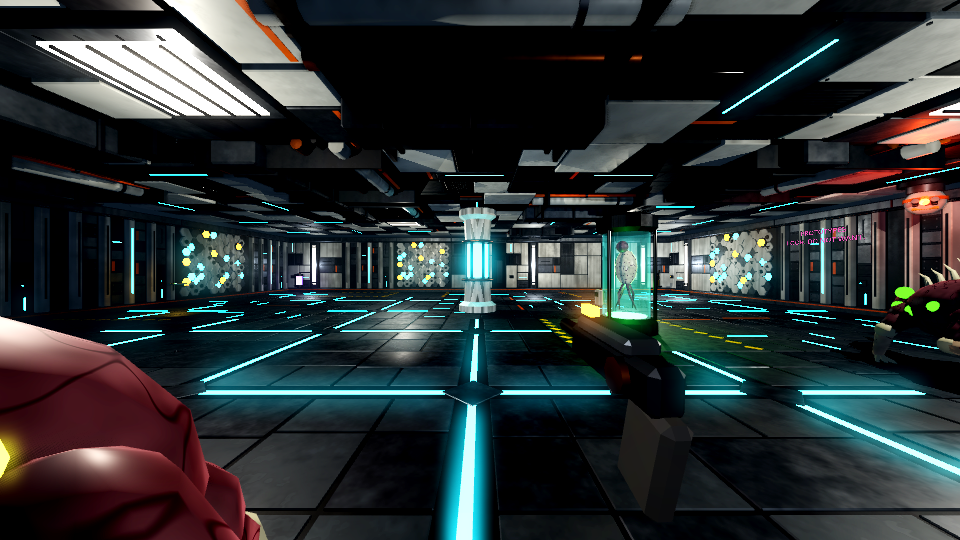

# maze3d: HaveNot in first person

A fast first-person shooter engine in Godot 4, and the first game on it: one level of HaveNot, *Kaveros Deepworks · Sublevel 1*, a ruined Age of War installation.

It is a separate codebase from the 2D Linear Maze engine in this repository (that one is JavaScript and canvas; this is a Godot project). It keeps the same idea: **the engine knows nothing about any game.** A game is a folder of data (weapons, monsters, items, levels) and one or more **kits** (tile sets: walls, floors, ceilings, doors, props, and the materials they wear).



## Running it

1. Open Godot 4.4 or newer (built and tested on 4.7.2) and import `maze3d/project.godot`. The first import takes a minute while Godot converts the models.
2. Press F5.

Controls: WASD move, mouse look, left click fire, Shift dash, Space jump, E use, 1–9 or the wheel to change weapon, F lamp, Tab bigger map, Esc pause.

The title screen offers the built level and **Random installation**, which is made on the spot by the example generator in `generators/rooms.gd`.

## What is here

| Folder | What it is |
|---|---|
| `engine/` | The engine: level builder, player, weapons, enemies, doors, props, pickups, traps, HUD, shaders. No game content. |
| `kits/hightech/` | The high-tech ruin kit: 11 walls, 6 floors, 5 ceilings, a pillar, 6 doors, 14 machines and props, 13 items, trap hardware, 3 weapons. `kit.json` (styles; hand-written), `generated.json` (what the model scripts wrote), `materials.json` (the look of each material name), `models/*.glb`. |
| `actors/` | Rigged, animated monsters as `.glb`: Gladiator Roach, Custodian, Monoid, Glorexx, ceiling turret. |
| `games/havenot/` | The game: `game.json`, `defs/` (weapons, projectiles, actors, items, sounds), `levels/`. |
| `generators/` | Level generators. `rooms.gd` is a small working example of the interface. |
| `tools/blender/` | The scripts that model everything (`mz.py` is the modelling library). Run them in Blender or with `pip install bpy`. |
| `tools/levels/` | The script that lays out the Deepworks level. |
| `SPEC.md` | The reference: file formats, conventions, and how to add a monster, a tile, a door, a prop, a kit, a level or a generator. |

## The level

Service Airlock → Concourse (front desk, WellPoint) → west to the Specimen Garden for the **blue card** → north through the passage grid (beams and a live floor; Fabrication, east, has the switch, and the scattergun) → Server Hall: route power → Reactor Hall, two storeys: the **red card** and the Plasma Musket, and taking them wakes the place up → the Prototype Vault and the freight lift out.

## About the art

Every model was written as a script and exported to glTF, so there is real geometry, real skeletons and real animation clips, but it is code-built art: clean, a bit blocky, and consistent. It is meant as a complete starting set to replace piece by piece. Any `.glb` can be opened in Blender, reworked or replaced with a hand-made model, and the game picks it up as long as it keeps the conventions in `SPEC.md` (size, facing, material names, clip names). There are no textures: surfaces get their wear from shaders (`engine/shaders/`), so a new model looks right as soon as it uses the kit's material names.

## Testing

```
godot --headless --path maze3d -- --level=deepworks --selftest
godot --headless --path maze3d -- --level=gen:rooms --seed=5 --selftest
```

The self-test plays the level by script: it walks and jumps, checks that everything placed can be reached, stands in every trap, fights every actor with every weapon in turn, opens every container, works every terminal, takes every pickup, opens every door and finishes the level. It prints PASS/FAIL lines and exits with the number of failures. Both commands above pass.

`-- --level=deepworks --at=15,21 --yaw=0 --shot=C:/tmp/a.png --frames=30` saves a picture from a given cell.

## Not done yet

- No saving. One level, start to finish.
- No HaveNot character creation, missions, vendors or hacking rolls: this is the shooter underneath.
- One enemy faction: everything hunts the player.
- Sound is synthesised placeholders (as in the 2D engine); no music.
- Balance has had scripted tests only, not a human play-through.
- Rendering was checked with Godot's Compatibility (OpenGL) renderer. The project is set to Forward+, which adds volumetric fog, SSAO and SSIL from the same settings; look at it on a real GPU and tune `engine/level.gd` `_build_environment` to taste.
