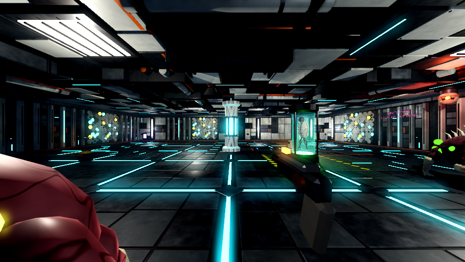

# maze3d: HaveNot in first person

A fast first-person shooter engine in Godot 4, and the first game on it: one level of HaveNot, *Kaveros Deepworks · Sublevel 1*, a ruined Age of War installation.

It is a separate codebase from the 2D Linear Maze engine in this repository (that one is JavaScript and canvas; this is a Godot project). It keeps the same idea: **the engine knows nothing about any game.** A game is a folder of data (weapons, monsters, items, levels) and one or more **kits** (tile sets: walls, floors, ceilings, doors, props, and the materials they wear).



## Running it

1. Open Godot 4.4 or newer (built and tested on 4.7.2) and import `maze3d/project.godot`. The first import takes a minute while Godot converts the models.
2. Press F5.

Controls: WASD move, mouse look, left click fire, Shift dash, Space jump, E use, 1–9 or the wheel to change weapon, F lamp, Tab bigger map, Esc pause, F9 save, F10 load (the pause screen has Save too, and the title screen Restore from save and New game). You carry two guns (three with a sling) and a pack of 12 bulk (more with a backpack): what does not fit stays where it lies; the HUD shows the pack beside your credits. At the bunker the armoury rack chooses what you take; by default, what you came home with. Hold the right mouse button for sniper mode (zoomed, slow). In easy mode, E also names what you are looking at (name, file id, kit, cell), and P then writes an image-generator prompt for it (low-poly, its measured colour scheme and proportions, its kit's style line) to the console, the clipboard and `image_prompts.txt` in the game's user folder. Wording: `games/havenot/prompts.json` and `kits/<kit>/prompt.json` (SPEC.md, "Image prompts").

The title screen offers the built level and **Random installation**, which is made on the spot by the example generator in `generators/rooms.gd`.

## What is here

| Folder | What it is |
|---|---|
| `engine/` | The engine: level builder, player, weapons, enemies, doors, props, pickups, traps, HUD, shaders. No game content. |
| `kits/hightech/` | The high-tech ruin kit: 11 walls, 6 floors, 5 ceilings, a pillar, 6 doors, 4 scanner arches, 2 wall lockers, 14 machines and props, 13 items, trap hardware, 3 weapons. `kit.json` (styles; hand-written), `generated.json` (what the model scripts wrote), `materials.json` (the look of each material name), `models/*.glb`. |
| `kits/agency/` | The Agency kit (the Anomalous Structure's Sterile White): 9 walls, 4 floors, 4 ceilings, 6 pieces of furniture, in porcelain, onyx, rose gold and pink neon. Borrows the high-tech kit's doors and machines. |
| `kits/works/` | The Works (under the Greasy Bolt Hole): riveted iron, sooty brick, furnace mouths, gear walls, hanging chains, conveyor and grease-drain floors, I-beam ceilings with hoists; forge, grease vat, press, workbench, drums; a chain-hauled iron shutter door. 6 walls, 3 floors, 3 ceilings, 5 props, 1 door. |
| `kits/bunker/` | The Bunker: board-marked concrete, olive steel, caged bulbs, locker and ration-shelf walls, a map wall with a radio; bunks, mess table, console, generator (the flywheel turns), decon shower, crates; a swinging blast door with a wheel. 8 walls, 3 floors, 3 ceilings, 6 props, 1 door. |
| `kits/crypt/` | The Crypt, the first kit that is not high-tech: coursed stone, rib vaults, stained-glass arches, bone walls, niches with urns and skulls, sconces; coffins whose lids slide (grave goods, or the occupant), hooded statues, plinths, braziers, candles, bone piles; a stone slab door that sinks into the floor. 8 walls, 3 floors, 3 ceilings, 6 props, 1 door. |
| `kits/executive/` | The Executive Floor (Dead Signal's board floor with a little more high-tech): ebony and rosewood panelling, green-veined black marble, jade, brass, amber light, cyan holo lines; bookshelf, market-screen, sconce and portrait walls; marble, herringbone, carpet and inlay floors; coffered ceilings and a rotunda dome; desk, boardroom table, club chair, bar, holo globe, display case; double doors. 7 walls, 4 floors, 3 ceilings, 6 props, 1 door. |
| `kits/megaplex/` | The Infinite Satisfaction Retail Megaplex: cream and teal mall tile, chrome, shopfronts, shutters, backlit ads, vending walls, a cinema's acoustic walls and screen; tile, checker, cinema-carpet and way-finding floors; grid, track-light, skylight, hanging-sign and starry cinema ceilings; kiosk, vending machine, cinema seats, food-court table, bench, auto-chef; automatic glass doors. 9 walls, 4 floors, 5 ceilings, 6 props, 1 door. |
| `kits/hospital/` | The Elective Suffering & Recovery Hospital: white tile with a teal band, bedhead service panels, drawn curtains, medicine cupboards, x-ray light boxes, a surgical theatre's observation window; lino, way-finding, tile and drain floors; drop ceilings, troffers, curtain rails and a surgical lamp; ward bed, operating table, medicine cabinet, gurney, monitor, privacy screen; swing doors with portholes. 7 walls, 4 floors, 4 ceilings, 6 props, 1 door. |
| `kits/basilica/` | The Basilica of the Blessed Brand: cream limestone and gold, logo glass in magenta, cyan and yellow, gilt-framed billboards, product niches with neon halos, organ pipes, votive racks; flagstone, logo-roundel and aisle-runner floors; rib vaults with neon halo chandeliers and banners; checkout altar, pew, sample font, pulpit, censer, reliquary; gilded gates. 8 walls, 3 floors, 3 ceilings, 6 props, 1 door. |
| `kits/robots/` | Robot stations: one for each kind of robot, with a shutter that closes over a hibernating one. 8 models. Every kit uses it. |
| `kits/loot/` | What treasure is kept in: shelves, a trophy case and a strongbox in each of nine places' own materials, a power-cell charging rack, a reliquary. 29 models. Every kit uses it. |
| `kits/drowned/` | Thalassa Deep Array: a high-tech installation that leaked for three hundred years. Sea-green and bronze, pale green light, round lit ribs; algae, slime, salt, rust, standing water. 13 walls, 6 floors, 5 ceilings, a hatch, 7 pieces of furniture. |
| `kits/dust/` | Helion Dust Station: a high-tech installation the desert got into. Bleached ivory and sandblasted steel, violet light, slanted lit fins; sand drifts, fallen tiles, cracks, hanging wiring. 13 walls, 6 floors, 5 ceilings, a shutter, 7 pieces of furniture. |
| `kits/home/` | The scavenger's own bunker: cozy brass steampunk that is still high technology. Walnut panelling, brass and copper pipe, gear trains that work the doors, oxblood leather, ceramic tile and oak, amber video in wood-and-brass cabinets; a white-tile bathroom; a grey armoured security room behind a vault door. 11 walls, 8 floors, 8 ceilings, 2 doors, 20 pieces of room furniture, 8 catalogue furnishings. |
| `kits/anomalous/` | The Anomalous Structure, Installation A of the 2D game: an Age of War advertising agency. Institutional offices (beige panels, carpet tile, a drop ceiling), a coffee shop, Sterile White labs, and the Core (black glass, pink traces). 13 walls, 8 floors, 7 ceilings, a force-field door, 30 props (reception desk, posters, cubicles, slot machine, coffee counter and tip jar, wall safe, test console, hologram, crates, mist generators, security station, repair gantry, the core), 4 things to carry and the arc carbine. |
| `kits/omni/` | No models: borrows every kit so one level can use them all. |
| `actors/source/` | Models made elsewhere, as they arrived: the Tripo Roach, Monoid and Glorexx. `tools/blender/adopt_*.py` turn them into `actors/*_tripo.glb` with clips. |
| `actors/` | 17 rigged, animated monsters as `.glb`: Gladiator Roach, Custodian, Monoid, Glorexx, ceiling turret; and Eggbot, Grease Monkey, Dancer, Snapper, Deadbot, Desktop Defender, Sphinx Gun, Plodder, Drone, Fouler, Mourner and the Princess. |
| `games/havenot/` | The game: `game.json`, `defs/` (weapons, projectiles, actors, items, sounds, the bunker), `levels/`. |
| `generators/` | Level generators. `rooms.gd` is a working example of the interface: a pipeline of stages in `generators/rooms/`. |
| `tools/blender/` | The scripts that model everything (`mz.py` is the modelling library). Run them in Blender or with `pip install bpy`. |
| `tools/levels/` | The scripts that lay out the hand-made levels, on the helpers in `levelkit.py` (grids, rooms, things against walls, signs, tags, door letters, writing the file). `staffonly.py` builds the test floor from whatever exists. |
| `tests/` | The self-test: a runner and one part per feature. A level's own test sits beside its level file (`games/havenot/levels/<id>_test.gd`). |
| `SPEC.md` | The reference, one section per subsystem: file formats, conventions, and how to add a monster, a tile, a door, a prop, a kit, a level or a generator. |
| `CHANGELOG.md` | What changed and when. |
| `CLAUDE.md` | Notes for whoever works on the code: where things live, the rules the code keeps, how to run the tests, size budgets. |

## The level

Service Airlock → Concourse (front desk, WellPoint) → west to the Specimen Garden for the **blue card** → north through the passage grid (beams and a live floor; Fabrication, east, has the switch, and the scattergun) → Server Hall: route power → Reactor Hall, two storeys: the **red card** and the Plasma Musket, and taking them wakes the place up → the Prototype Vault and the freight lift out.

Off the Concourse, south: the **Brand Experience Suite**, the Agency's showroom, still open. A security arch on the way in minds long guns (go early, or talk the front desk into an open day); domes lift off pedestals, at a price; Focus Group B is in session behind a toll arch. Around the level: a MediScan arch, a quartermaster arch, and wall lockers. Most lockers hold something useful. The dented ones that knock don't.

**The Menagerie** is a second, small level: a ticket hall, then three halls (Works, Bunker, Crypt) with the twelve newer monsters in them. It is there to look at things and to shoot them.

The title screen also offers random installations in each place: mixed, The Works, The Bunker, The Crypt, and "All the way down", which uses every kit and every monster and keeps the Princess in the last room.

**Home** is your bunker, first on the title screen: bedroom, bathroom, den, living room, communications room, armoury, robot room, and a security room behind a vault door where the lift is. Nothing in it fights. What you carry out of an installation alive is banked there (`user://havenot_home.json`): credits, the weapons on the armoury rack, the vest on the stand, trophies in the den's case. The ledger on the den's desk sells furnishings, and **B** puts them down wherever you like (click to place, R to turn, Z for the next thing, X to take one back). The dead Custodian in the robot room can be repaired with 3 circuit boards and 2 fuel cells brought home. The lift goes to any installation, and takes the armoury with you. The end-of-level screen offers the way home.

**The Anomalous Structure** is the 2D game's first installation, rebuilt: three floors in one level, joined by two lifts. Floor 1, Reception and Offices: the Sphinx Gun at reception wants the company slogan (it is on a poster by the front doors); the BLUE card is in locker 4 behind a staff door (the code is on a memo; the door wants an ID badge, which the Monoid in the break room will swap for the lucky chip in the coffee shop's tip jar, or lose in a fight, or the panel can be argued with); courtesy darts in the east hall; the executive suite's safe holds Termination Order 77-B. Floor 2, Prototype Labs: the testing chamber's three modes (read the Director's notes first), stasis tubes, toxic and harmless mist, the YELLOW card. Floor 3, Security Complex: a tripwire and Emergency lighting, the Heavy Security Drone, the Security Station (traps off, armoury open, the RED card), the Robot Repair Bay that rebuilds what you destroy, the arc carbine, and the inner core behind its field. Close the agency with the order, by argument, or by force; decide what happens to the ads; walk out of the front doors. You can leave at any time with what you are carrying.

**Staff Only** is the test floor, and it has everything: a room in every style of every kit, one of every piece of furniture and every door, every monster (wandering, lounging, perched, and every robot in its station open and shut), every loot container, a gun range, a lift, a pit, a pool, balconies, a loft, a basement, arches, traps, lockers, a blue card, a red card and a way out. Everything on it is off duty: press E on a monster to talk to it (the Sphinx Gun asks riddles, the Monoids complain and offer you a smoke, the Knife Fighter insults you), and ask it to show you what it does: it goes to the gun range, or shoots the target beside it, and does not shoot you. It is written by `tools/levels/staffonly.py` from whatever kits, monsters and items exist; run that again after adding anything.

**The Depot** is a small level to look at things in: every robot's station, open along the north wall and shut along the south, with the robot in it; and next door every kind of loot container, stocked.

**The Atrium** is a fourth small level for level shapes: an annexe with a thin wall and two windows, opening into an eight-sided hall three storeys high with a balcony at the first storey, another at the second, ramps between, and windows through to a control room. Enemies you have seen show red on the map.

## About the art

Every model was written as a script and exported to glTF, so there is real geometry, real skeletons and real animation clips, but it is code-built art: clean, a bit blocky, and consistent. It is meant as a complete starting set to replace piece by piece. Any `.glb` can be opened in Blender, reworked or replaced with a hand-made model, and the game picks it up as long as it keeps the conventions in `SPEC.md` (size, facing, material names, clip names). There are no textures: surfaces get their wear from shaders (`engine/shaders/`), so a new model looks right as soon as it uses the kit's material names.

## Testing

```
godot --headless --path maze3d -- --level=deepworks --selftest
godot --headless --path maze3d -- --level=gen:rooms --seed=5 --selftest
godot --headless --path maze3d -- --level=anomalous --selftest --story
```

The self-test plays the level by script: it checks the data's keys, walks and jumps, checks that everything placed can be reached, stands in every trap, fights every actor with every weapon in turn, opens every container, works every terminal, takes every pickup, opens every door and finishes the level. It prints PASS/FAIL lines and exits with the number of failures. The commands above pass. `CLAUDE.md` lists the full baseline and how to compare two versions exactly.

`-- --level=deepworks --at=15,21 --yaw=0 --shot=C:/tmp/a.png --frames=30` saves a picture from a given cell.

## Not done yet

- No saving inside a level. The bunker (Home) is what lasts between levels.
- The outdoor near-area map from the 2D game is not built yet: the bunker's lift goes straight to an installation.
- No HaveNot character creation, missions, vendors or hacking rolls: this is the shooter underneath.
- One enemy faction: everything hunts the player.
- Sound is synthesised placeholders (as in the 2D engine); no music.
- Balance has had scripted tests only, not a human play-through.
- Rendering was checked with Godot's Compatibility (OpenGL) renderer. The project is set to Forward+, which adds volumetric fog, SSAO and SSIL from the same settings; look at it on a real GPU and tune `engine/level/environment.gd` (`LevelEnvironment`) to taste.
